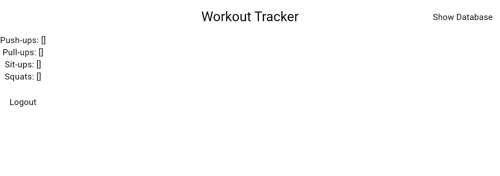

# Workout List

Next, we will create a component to display each workout in the list.

## Assignment

Create a component called `ExerciseCard` that displays the name of the exercise and the number of sets and reps for now.

Your output should look like this:



This UI is ugly, but we will add styling in the last lesson. Here, we want to see the output for each of the workouts.

### Requirements

1. Create a component called `ExerciseCard` that displays the name of the exercise and the number of sets and reps for now.
2. Use the `ExerciseCard` component for each workout in the list.

> **Hint:** You can use `...` to expand the workout object and map those to the `ExerciseCard` component.
>
> ```dart
> ...workoutViewModel.exerciseSets.entries
>    .map((entry) => ExerciseCard(
>          name: entry.key,
>          exercise: entry.value,
>        )),
> ```
>
> This will map each exercise set to the `ExerciseCard` component.

## Challenge

Code: [starter code](code/initial) · [solution](code/solution)

Start in `lib/workout/workout_view.dart`. Tests: `test/create_account_test.dart`, `test/login_test.dart`, `test/workout_test.dart`, `test/user_service_test.dart`, `test/workout_view_model_test.dart`.

---

[← Course overview](../../../README.md)
