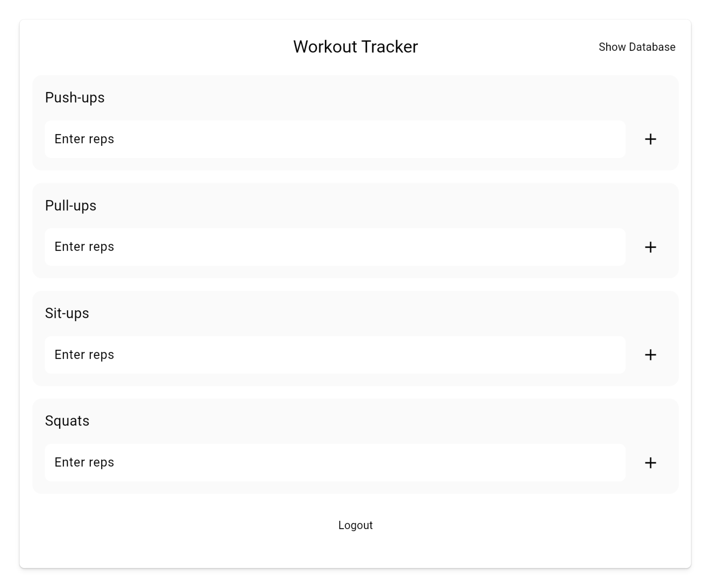

# Add Styling

Next, we have to make this UI more presentable.

## Assignment

Add styling to the `ExerciseCard` component.

Your output should look like this:

### Requirements

1. Each exercise should be within a `Card` widget with a background color of `Colors.grey[50]` and a `borderRadius` of 12.
2. Inside the `Card` widget should be a `Column` with 16 padding and aligned to the left.
3. Within the `Column` should be a `Text` widget with the exercise name, font size 18, and font weight of `w500`.
4. Below the exercise name, there should be 16 spacing and then a `Row` widget.
5. The `Row` widget should contain a full-width `TextField` with a border radius of `8` and an `IconButton` that clears the text within the input field when pressed.

## Challenge

Code: [starter code](code/initial) · [solution](code/solution)

Start in `lib/workout/workout_view.dart`. Tests: `test/create_account_test.dart`, `test/login_test.dart`, `test/workout_test.dart`, `test/user_service_test.dart`, `test/workout_view_model_test.dart`.

---

[← Course overview](../../../README.md)
