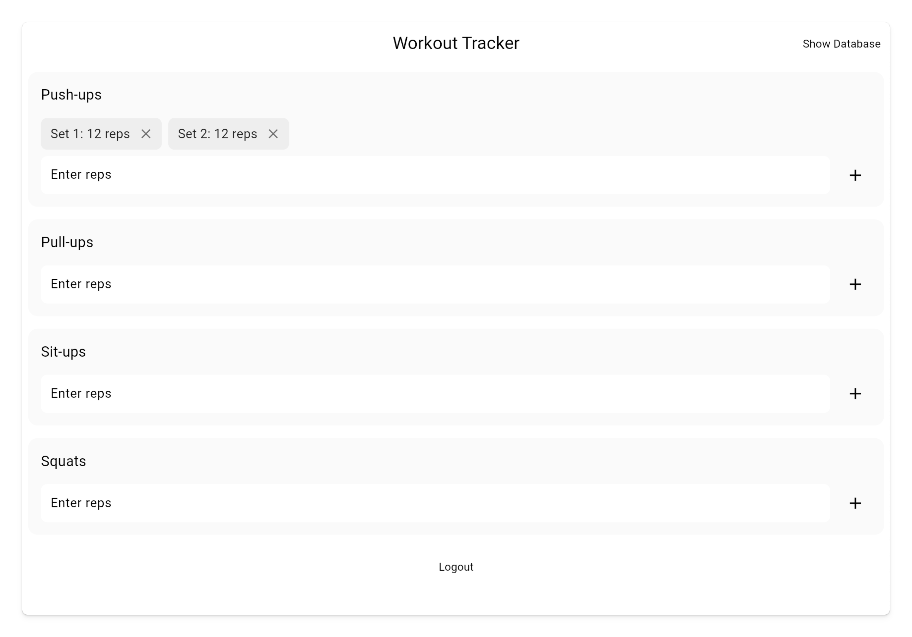

# Add and Remove Sets

Let's implement the functionality and UI for adding and removing sets.

## Assignment

You should be able to type in the number of reps you did for each set, then click the `+` button to add that set and see it visually above the input field.

Then, you should be able to click the cross to delete that specific set.

The result should look like this:

### Requirements

1. When the user clicks the `+` button, a new set should be added to the list.
2. Display the set list in a `SingleChildScrollView` to allow horizontal scrolling.
3. Use a `Row` to display each set.
4. Each set item should have a `Colors.grey[200]` background, 12 padding on the left, and a `borderRadius` of `8`.
5. Text within should be `Set ${index + 1}: ${value[index]} reps` with font size 16 and `Color.black87` color.
6. Have an `IconButton` with an `Icons.close` icon to remove the set.

## Challenge

Code: [starter code](code/initial) · [solution](code/solution)

Start in `lib/workout/workout_view.dart`. Tests: `test/create_account_test.dart`, `test/login_test.dart`, `test/workout_test.dart`, `test/user_service_test.dart`, `test/workout_view_model_test.dart`.

---

[← Course overview](../../../README.md)
