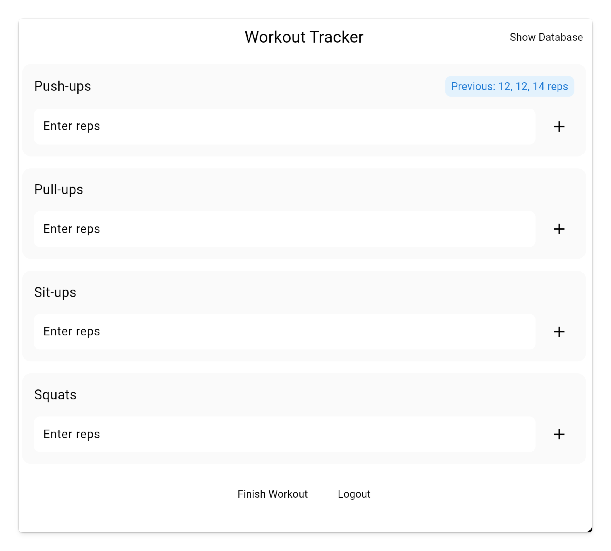

# Show Previous Workouts

Now, we need to display that information in the UI.

## Assignment

In the top right corner of the card, show the previous workout information.

The result should look like this:

### Requirements

1. Create a row around the Exercise name with an alignment of `spaceBetween`.
2. Add a `ValueListenableBuilder` that listens to the `previousSessionSets` for the specific exercise.
3. If there are no previous sets, don't display anything.
4. If there are, display a container with 8 horizontal padding and 4 vertical padding, border radius of 8, and a background of `Colors.blue[50]`.
5. Within the container, display the text `Previous: ${previousSets.join(", ")} reps` with a `Colors.blue[700]` color and font size of 14.

## Challenge

Code: [starter code](code/initial) · [solution](code/solution)

Start in `lib/workout/workout_view.dart`. Tests: `test/create_account_test.dart`, `test/login_test.dart`, `test/workout_test.dart`, `test/user_service_test.dart`, `test/workout_view_model_test.dart`.

---

[← Course overview](../../../README.md)
