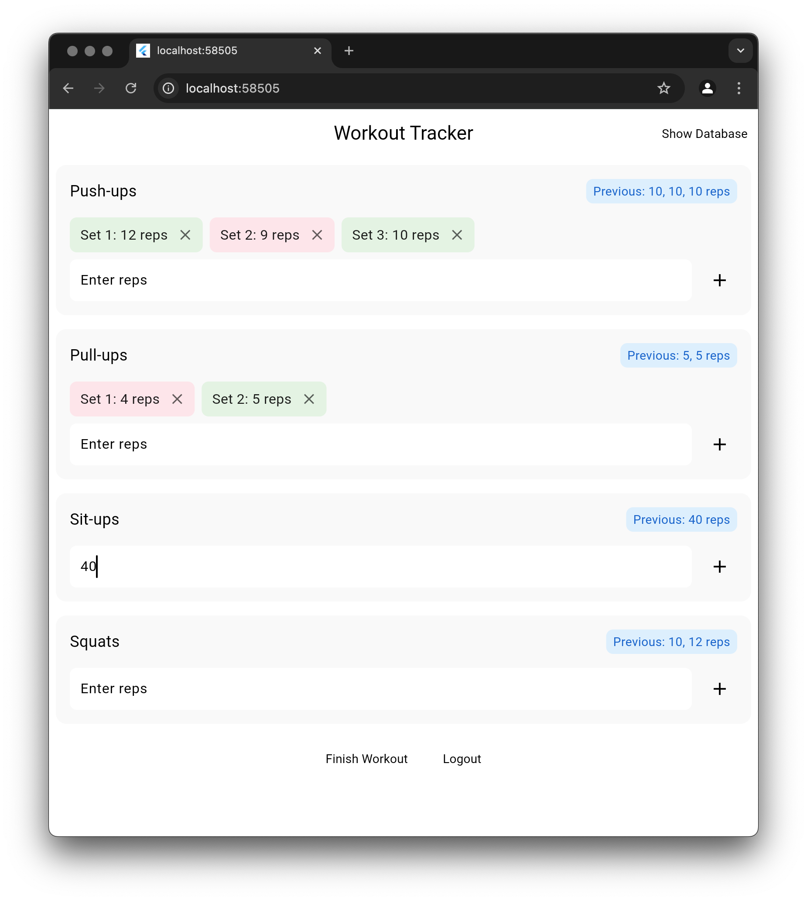

# Show Progress Colors

The final step is to make our app more fun and tell you visually how you are doing.

## Assignment

Set the current sets to have a color based on whether they are better or worse than the previous workout. Use green if it's a tie because you still did good.

The result should look like this:

### Requirements

1. If the current set is the same as the previous set, set the color to `Colors.green[50]`.
2. If the current set is better than the previous set, set the color to `Colors.green[50]`.
3. If the current set is worse than the previous set, set the color to `Colors.red[50]`.

## Challenge

Code: [starter code](code/initial) · [solution](code/solution)

Start in `lib/workout/workout_view.dart`. Tests: `test/create_account_test.dart`, `test/login_test.dart`, `test/workout_test.dart`, `test/user_service_test.dart`, `test/workout_view_model_test.dart`.

---

[← Course overview](../../../README.md)
